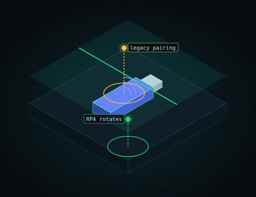

<p align="center"></p>

<h1> ble-doctor</h1>

[](https://github.com/doctor-labs/ble-doctor/actions/workflows/ci.yml)
[](https://crates.io/crates/ble-doctor)
[](LICENSE)
[](docs/doctor-contract.md)
[](#use)

**Examines a Bluetooth LE device or a btsnoop/pcap capture and answers: how exposed is its pairing, GATT surface and privacy, and what should be fixed first?**

A single cross-platform Rust CLI that scores the result and reports findings as `doctor/1` JSON or SARIF. Defensive, CTF and own-gear use only. Successor to the archived Python ble-doctor-v1.

```text
$ ble-doctor analyze s.btsnoop --headless
capture: btsnoop-h4 (0 adv frames)
smp: 2 PDUs
smp: pairing method just_works, legacy pairing, max key size 16
ble-doctor 0.3.0  score 60/100 needs work
high      smp_legacy_pairing     s.btsnoop  SMP legacy pairing: LE Secure Connections not set by both sides; the key exchange is passively crackable.
medium    smp_just_works         s.btsnoop  SMP Just Works association: unauthenticated, no MITM protection.
info      mac_rotation           s.btsnoop  Not enough advertisement frames captured to judge MAC rotation.
1 high · 1 medium · 1 info
```

Without `--headless` the report is drawn by a doctor-kit face (`--face rich|plain|compact`, `--theme mono|clinical|contrast`, `--color`); `--score` prints only the number.

The capture is a two-packet btsnoop (a legacy Just Works pairing exchange) built by the `analyze_extracts_smp_pairing` test in `tests/conformance.rs`. The command exits 1 because a `high` finding is present.

## Install

```sh
cargo install ble-doctor
```

From source: `cargo build --release` (Linux needs `libdbus-1-dev` and `pkg-config`). Tagged releases also attach binaries for Linux, macOS and Windows (`release.yml`).

## Use

| Command | What it does |
|---|---|
| `ble-doctor scan --target <addr>` | Scan, connect and score a device (`--json`, `--sarif FILE`, `--baseline FILE`, `--fail-on SEV`, `--tui` opens the explorer first) |
| `ble-doctor analyze <capture>` | Score a btsnoop/pcap capture, including SMP pairing (`--json`, `--sarif`, `--baseline`, `--fail-on`, `--irk HEX` to resolve RPAs you hold the IRK for) |
| `ble-doctor shell --target <addr>` / `--capture <file>` | Interactive shell over the findings and the device's services (`ls`, `cd`, `cat`, `why`, `export`; `-c "ls; cat 1"`, `--json` for agents); over a live target also `read`, `write`, `recon`, `probe-writes` |
| `ble-doctor explore --target <addr>` / `--capture <file>` | Full-screen explorer over the same session |
| `ble-doctor fix [--from report.json]` | A prompt for a coding agent from one finding or the whole report |
| `ble-doctor install`, `ble-doctor ci install` | Write the agent skill / Cursor rule / AGENTS.md block, or a GitHub Actions workflow that analyzes `captures/` |
| `ble-doctor fingerprint --target <addr>` | LE+GATT profile (plus SDP/LMP on Linux) |
| `ble-doctor recon`, `read-values`, `probe-writes`, `dfu`, `sniff`, `mitm`, `ctf` | Active and empirical probes; own-gear scope |
| `ble-doctor rules`, `why`, `baseline`, `handoff`, `doctor` | Rule docs, finding explanations, baseline snapshots, handoff bundle, environment check |
| `ble-doctor mcp` | MCP server exposing `scan` and `analyze` |
| `ble-doctor serve [--listen host:port] [--timeout secs]` | Read-only REST API: `GET /scan` (one JSON array), `GET /events` (same scan as Server-Sent Events) |

Run `ble-doctor <command> --help` for every flag. Build progress is tracked in the repo issues; see `docs/` for design and the deferred-test checklist.

## Machine output


`scan --json` and `analyze --json` print one `doctor/1` envelope (`schema`, `tool`, `version`,
`exit_code`, `score`, `findings`, `data`); see [`docs/doctor-contract.md`](docs/doctor-contract.md).
Both also take `--sarif FILE`, `--baseline FILE` (a previous envelope) and `--fail-on SEV`
(default `high`).

- `analyze` also decodes SMP pairing (Pairing Request/Response, key size, Pairing Failed...) into `data.smp` and checks it (`smp_legacy_pairing`, `smp_just_works`, `smp_key_size`, `smp_pairing_failed`; see `ble-doctor rules explain <id>`).
- `fingerprint --target <addr> [--json]` (not a findings command, no envelope) prints the LE+GATT profile. On Linux with
  CAP_NET_RAW and a dual-mode target it also fills `sdp` and `lmp` (#64): LMP version -> Core version
  (`version`), company id + `manufacturer_name`, `subversion`, and feature pages 0..2 (`pages` hex, named `features`,
  Core Spec Vol 2 Part C 3.3), read with HCI Read Remote Supported/Extended Features and Read Remote Version
  Information on hci0 over the ACL link the SDP query opens. Elsewhere it prints "SDP/LMP need a Linux host".
  Unit-tested against byte fixtures and a mocked transport only; live validation is #70.
- `findings` holds failed checks only; passed checks are under `data.passed`, and `analyze` puts the
  parsed capture under `data.capture`.
- `category` is the rule's catalog category (`gatt`, `privacy`, `dfu`); `remedy` is the rule doc's
  "How to fix" text; `location` is `{"kind":"device","ref":<target>}` for `scan` and
  `{"kind":"file","ref":<capture path>}` for `analyze`.
- `fingerprint` = first 16 hex of sha256(`rule id`, newline, device identity), the same value as the
  SARIF `partialFingerprints["doctorFinding/v1"]`. Device identity is the `--target` as passed
  (trimmed, uppercased) for `scan`, and for `analyze` the single advertising address in the capture
  (empty when it rotates). Severity, message wording and the capture path are not part of it, so
  baselines survive re-rating and match across captures of one device.
- Score `ble/1`: `100 * prod(1 - w/100)` over failed checks (critical 50, high 30, medium 15, low 5,
  info 0), half-up rounded. `coverage_gaps` counts checks flagged `inconclusive` (capture too short to judge
  MAC rotation, GATT not fully enumerated, signing status unknown); with a gap, a score of 90+ is labelled `incomplete`.
- Exit codes: 0 clean, 1 a finding at or above `--fail-on`, 2 error (usage, bad input, radio or
  I/O failure), 3 `--baseline` and a NEW finding at or above `--fail-on`, 130 SIGINT. The
  `doctor` environment check keeps its own codes (0, or 1 on a hard failure); it emits no findings.
- With `--json`, stdout carries only the envelope; the scan device list and baseline diff go to stderr.
- Terminal output (scan, analyze, recon, fingerprint, read-values, probes, dfu, ctf) strips control, bidi and zero-width characters from device-supplied strings.
- `mitm --target <addr> --allow-dangerous` (not a findings command, no envelope; Linux + 2 BLE
  adapters + peripheral mode only, `--allow-dangerous` required) connects to `--target`, clones its
  GATT onto a local peripheral via BlueZ/bluster, advertises it, and relays every victim
  read/write to the real device, logging each exchange, until Ctrl-C. Forwarding the real device's
  own notifications/indications into the victim's subscription is not implemented. Elsewhere, or
  with one adapter, it prints a clean "not supported"/"needs a second adapter" error. GATT-tree
  construction and the relay/event-handling are unit-tested against a mocked transport; live
  validation on real radios is #68.
- MCP (`ble-doctor mcp`): tools `scan` and `analyze` return the same envelope and accept
  `baseline`, `fail_on` and `sarif`. Not exposed over MCP: `--tui`, `--mtu`, `--as-address`,
  `--timeout`, `--adapter`, and every probe/write command.

Part of [doctor·labs](https://github.com/doctor-labs) — offline security doctors.
